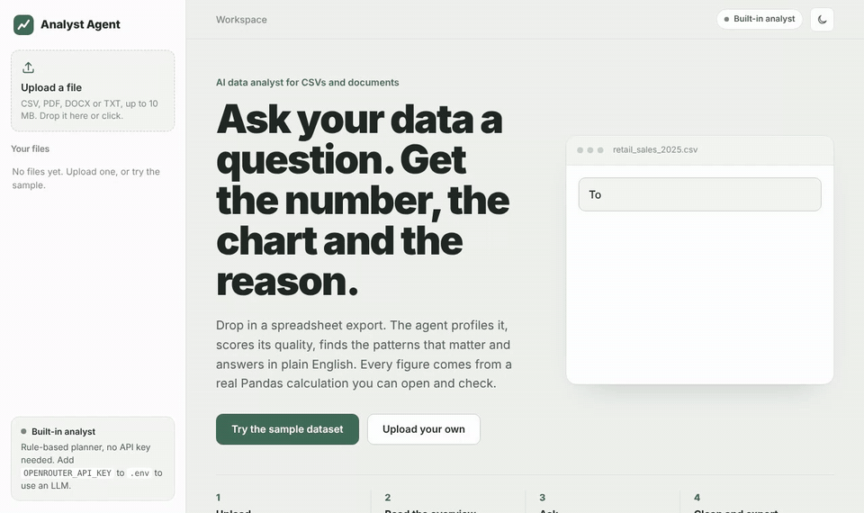
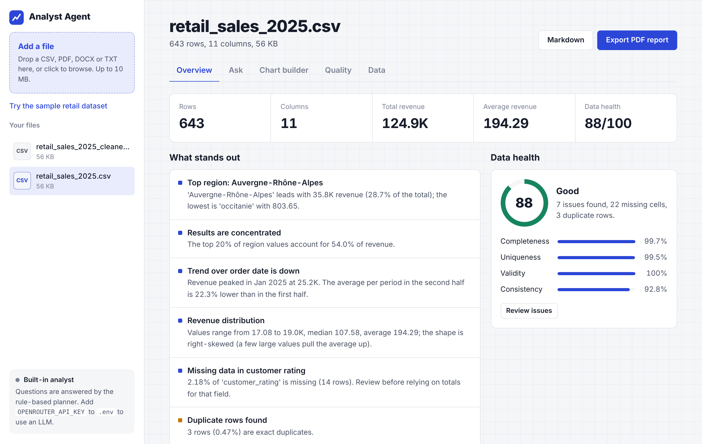
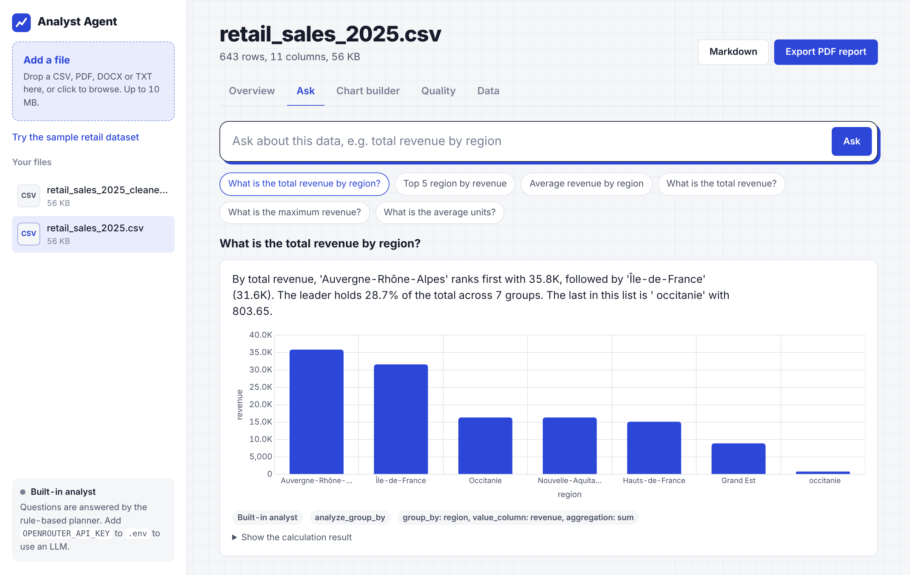
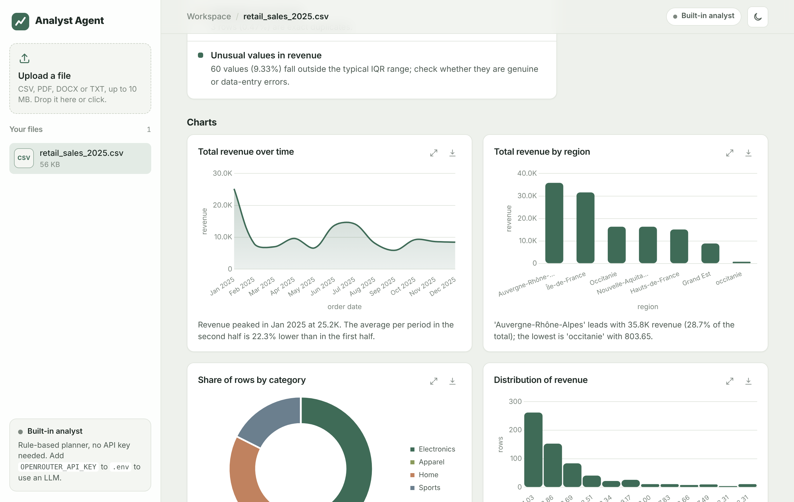
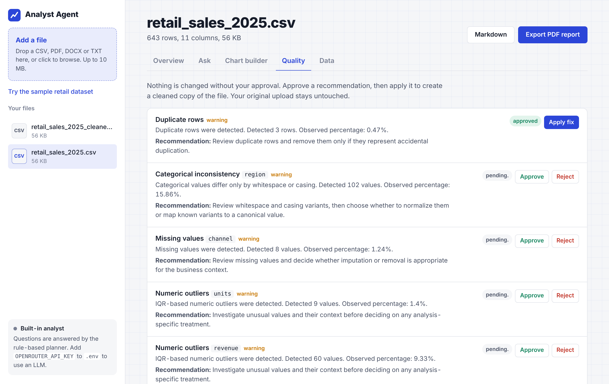
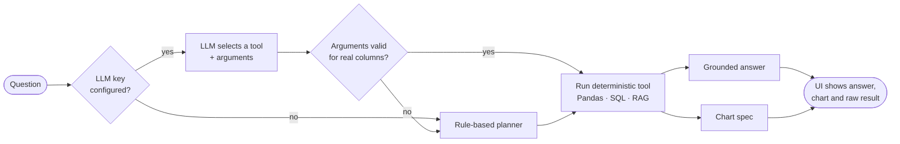
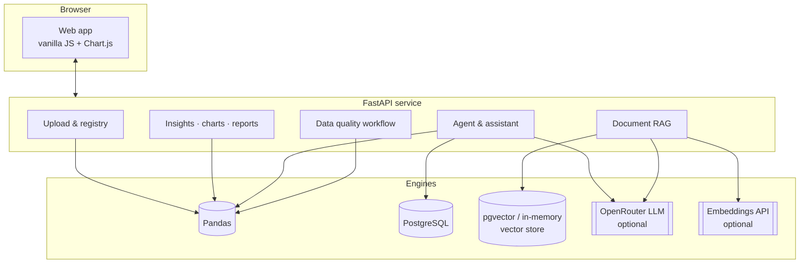
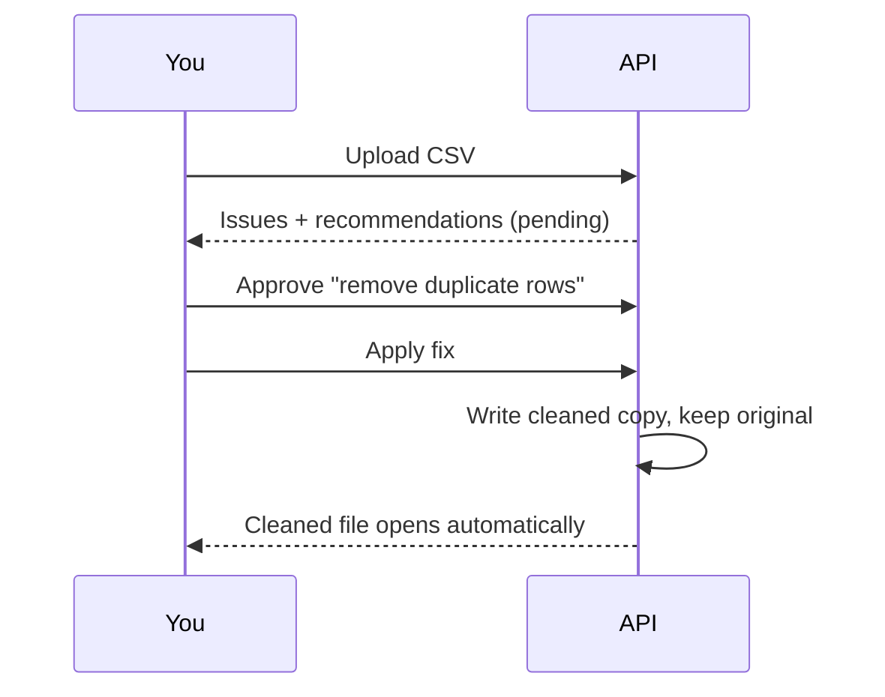

<p align="center">
  
</p>

<p align="center">
  <a href="https://ai-data-analyst-agent-wbvy.onrender.com"></a>
  
  
  
  
  
</p>

<p align="center">
  <a href="https://ai-data-analyst-agent-wbvy.onrender.com"><b>Live demo</b></a> ·
  <a href="#-see-it-in-action"><b>Demo</b></a> ·
  <a href="#-how-it-works"><b>How it works</b></a> ·
  <a href="#-quick-start"><b>Quick start</b></a> ·
  <a href="#-api"><b>API</b></a>
</p>

---

Upload a CSV and get what a junior analyst would hand you on day one: **key metrics, a data-health score, the patterns that stand out, ready-made charts, and answers to plain-English questions**. Then export a PDF report. You can also upload PDF, Word and text documents and ask questions about them with retrieval-augmented generation (RAG).

> [!IMPORTANT]
> **The LLM never invents numbers.** It only chooses *which* validated analysis tool to run, with arguments checked against the real columns. Every figure comes from a deterministic Pandas or SQL calculation, and the raw result is shown under each answer.

> [!TIP]
> Open the [live demo](https://ai-data-analyst-agent-wbvy.onrender.com) and click **Try the sample dataset**. It runs on Render's free plan, so the first load after a quiet period can take up to a minute.

## 🎬 See it in action

<p align="center">
  
</p>

<table>
  <tr>
    <td width="50%"><p align="center"><sub><b>Overview</b>: KPIs, findings and a 0–100 health score</sub></p></td>
    <td width="50%"><p align="center"><sub><b>Ask</b>: plain-English questions, grounded answers, auto chart</sub></p></td>
  </tr>
  <tr>
    <td width="50%"><p align="center"><sub><b>Charts</b>: suggested automatically, enlarge or download as PNG</sub></p></td>
    <td width="50%"><p align="center"><sub><b>Quality</b>: detect, recommend, approve, then apply</sub></p></td>
  </tr>
</table>

## ✨ Features

| | |
|---|---|
| 📊 **Instant overview** | Detects column roles (metric, category, date, identifier) and surfaces the top segment, concentration, trend, distribution shape, correlations, missing data and outliers. |
| 🩺 **Data health score** | A 0–100 score built from completeness, uniqueness, validity and consistency, with a penalty for each detected issue. |
| 💬 **Ask in plain English** | With an API key, an LLM selects a tool (`analyze_group_by`, `sql_top_n`, `rag_ask`, …). Without one, a built-in rule-based planner answers totals, averages, rankings and breakdowns, and understands partial column names and business words like *revenue* and *sales*. |
| 📈 **Chart builder** | Bar, line, doughnut, pie, histogram and scatter for any columns, with sum, average, median, min, max or count. |
| 🧹 **Human-approved cleaning** | Issues become recommendations. A person approves or rejects each one, and approved fixes write a *new* cleaned file. The original upload is never modified. |
| 📄 **One-click reports** | A styled PDF with KPIs, health, findings, charts, recommendations and a column overview, or a Markdown version. |
| 📚 **Document Q&A (RAG)** | PDF, DOCX and TXT extraction, deterministic chunking, embeddings, vector search (in memory or pgvector) and answers with cited passages. |
| 🗄️ **SQL backend** | CSVs can be ingested into PostgreSQL, and the agent chooses between Pandas and SQL tools. |
| 🔒 **Safe by design** | Filename and path-traversal protection, size and content-type limits, UUID file IDs with content fingerprints, read-only analysis and standard error codes. |

<details>
<summary><b>💬 Questions the built-in analyst understands (no API key needed)</b></summary>

| Type | Examples |
|---|---|
| **About the table** | what is this data about · list all columns · what are the data types · how many rows · show me the first 5 rows |
| **Data quality** | any missing values? · missing values in customer rating · are there duplicates? · is the data clean? |
| **One column** | describe revenue · unique values of region · what are the categories · most common product · how many customers |
| **Dates & trends** | what is the date range? · revenue by month · quarterly revenue · monthly orders |
| **Calculations** | total revenue · average discount · total revenue by region · top 3 products by revenue |
| **Rankings** | which region has the highest revenue · the best selling product · the worst performing region · highest revenue order |
| **Filters** | total revenue for Electronics · average revenue in Occitanie · how many orders online · revenue in March · total revenue in 2025 |
| **Comparisons & share** | compare online vs store revenue · what percentage of revenue comes from electronics · share of orders from online |
| **Best periods** | which month had the highest revenue · busiest month · which quarter had the most orders |
| **Two-way breakdowns** | revenue by region and channel |
| **Relationships & outliers** | correlation between units and revenue · what correlates with revenue · are there any outliers in revenue? |
| **Insights** | give me insights · what are the key insights |
| **Help** | help · what can I ask? |

Column names don't need to be exact: *products* finds `Product Category`, and *revenue* or *sales* finds the main money column.
</details>

## 🧠 How it works

**Answering a question**



**Architecture**



**Data quality: a human stays in the loop**



## 🛠️ Tech stack

| Layer | Tools |
|---|---|
| **Backend** | Python, FastAPI, Pydantic, Uvicorn |
| **Data** | Pandas, NumPy, SQLAlchemy, PostgreSQL |
| **AI** | OpenRouter (LLM tool-calling), OpenAI-compatible embeddings, pgvector |
| **Documents** | pypdf, python-docx, ReportLab (PDF reports) |
| **Frontend** | Vanilla JavaScript, Chart.js, CSS (light and dark themes) |
| **Quality** | pytest (444 tests), ruff |
| **Delivery** | Docker, Docker Compose, Render |

## 🚀 Quick start

Requires **Python 3.11+**.

<table>
<tr><th>Windows (PowerShell)</th><th>macOS / Linux</th></tr>
<tr>
<td>

```powershell
.\run.ps1
```

</td>
<td>

```bash
./run.sh
```

</td>
</tr>
</table>

Open **http://127.0.0.1:8000** and click **Try the sample dataset**. Interactive API docs are at **/docs**.

<details>
<summary><b>Manual setup</b></summary>

```bash
python -m venv .venv
.venv\Scripts\activate          # Windows  (source .venv/bin/activate on macOS/Linux)
pip install -r requirements.txt
uvicorn backend.app.main:app --reload
```
</details>

<details>
<summary><b>Docker (API + web app + PostgreSQL/pgvector)</b></summary>

```bash
cp .env.example .env     # optional: add API keys
docker compose up --build
```
</details>

<details>
<summary><b>Optional configuration (.env)</b></summary>

Everything except LLM and document Q&A works without keys.

| Variable | Enables |
|---|---|
| `OPENROUTER_API_KEY` | LLM tool-calling agent and grounded answers (default model `openai/gpt-4o-mini`) |
| `EMBEDDING_API_KEY` | Document indexing and Q&A (OpenAI-compatible embeddings) |
| `POSTGRES_*` | SQL ingestion and analysis, plus a durable pgvector RAG index |
| `EMBEDDING_VECTOR_STORE` | `memory` (default, local only) or `postgres` (durable) |

The sidebar shows which mode is active.
</details>

## 🔌 API

<details>
<summary><b>Main endpoints</b> (full OpenAPI docs at <code>/docs</code>)</summary>

| Method | Path | Purpose |
|---|---|---|
| POST | `/upload` | Upload CSV, PDF, DOCX or TXT (≤ 10 MB) and receive a `file_id` |
| GET | `/files` | List uploaded files |
| GET | `/insights?file_id=` | KPIs, health score, findings, charts, column summary, preview |
| POST | `/charts` | Build a chart spec from any columns |
| POST | `/assistant/ask` | Ask a question (LLM agent with offline fallback) |
| GET | `/report?file_id=&format=pdf\|md` | Download the analysis report |
| GET | `/data-quality/recommendations?file_id=` | Quality recommendations |
| POST | `/data-quality/recommendations/{id}/approve` · `/reject` | Human review |
| POST | `/data-quality/apply` | Apply an approved fix and register the cleaned file |
| POST | `/documents/index/{file_id}` · `/documents/ask` | RAG indexing and Q&A |
| POST | `/database/ingest/{file_id}` · `/database/analyze` | PostgreSQL ingestion and SQL analysis |
| GET | `/status` | Which AI features are configured |

```bash
curl -F "file=@sample_data/retail_sales_2025.csv" http://127.0.0.1:8000/upload
curl -X POST http://127.0.0.1:8000/assistant/ask \
     -H "Content-Type: application/json" \
     -d '{"file_id": "<id>", "question": "top 3 products by revenue"}'
```
</details>

## 🧪 Testing

```bash
python -m pytest -q
```

**444 tests** cover ingestion edge cases, security, data quality, cleaning, the analysis tools, the LLM planner and tool selection (with mocked providers), RAG, persistence, insights, reports and the offline assistant. They run against an isolated temporary upload directory and need no API keys or database.

## 🗂️ Project structure

<details>
<summary><b>Show the tree</b></summary>

```
ai-data-analyst-agent/
├── backend/
│   ├── app/
│   │   ├── api/routes/     # FastAPI routers (upload, insights, agent, quality, documents, …)
│   │   ├── analysis/       # deterministic Pandas + SQL analysis
│   │   ├── insights/       # column roles, health score, findings, charts, offline planner, reports
│   │   ├── quality/        # detection → recommendations → approval → cleaning
│   │   ├── llm/            # OpenRouter client, planner, grounded answers
│   │   ├── tools/          # tool registry, schemas, validated tool selection
│   │   ├── services/       # document extraction, chunking, embeddings, retrieval, QA
│   │   ├── repositories/   # vector stores (memory / pgvector)
│   │   ├── ingestion/      # safe uploads, file registry, CSV reader, profiler
│   │   └── main.py
│   └── tests/              # 444 pytest tests
├── frontend/               # web app (HTML, CSS, JS) served at /app
├── sample_data/            # demo retail dataset
├── docs/                   # banner, demo GIF, screenshots
├── Dockerfile · docker-compose.yml
└── run.ps1 · run.sh
```
</details>

## 🧭 Design decisions

- **Deterministic first.** Numbers come from code, not from a model. The LLM's job is narrowed to choosing a tool, which makes answers verifiable and testable.
- **Graceful degradation.** No key, a provider outage or an invalid tool call all fall back to the rule-based planner instead of failing.
- **Human in the loop.** Cleaning never happens silently. Every change needs approval and produces a new file, so the original data stays intact.
- **Security over convenience.** Uploads are addressed by UUID, fingerprinted against tampering, and validated for name, size and type.

<details>
<summary><b>Persistence details</b></summary>

| Data | Where it is stored | Survives an API restart |
|---|---|---|
| Uploaded files | `backend/app/uploads/` | Yes |
| Upload records (`file_id`) | `backend/app/uploads/.upload_registry.json` | Yes, if the file still exists unchanged |
| SQL ingestion registry | `backend/app/uploads/.database_ingestion_registry.json` | Yes, after the table is re-verified |
| Ingested SQL tables | PostgreSQL | Yes |
| RAG index (`postgres`) | PostgreSQL with pgvector | Yes |
| RAG index (`memory`) | API process memory | No: re-index after a restart |

Quality approval status is held in memory. The registry files support a single API process.
</details>

## 🗺️ Roadmap

- [ ] Join several CSVs (for example orders, products and sellers) and ask across them
- [ ] Persistent cloud storage for uploads on the hosted demo
- [ ] Scheduled email reports
- [ ] User accounts and per-user workspaces

## 👤 Author

**Thirumurugan Kumar**, MSc Data Science & Analytics, EPITA Paris

[](https://github.com/thirurishi)
[](https://thiruuportfolio.netlify.app)

If this project is useful or interesting, a ⭐ helps others find it.
